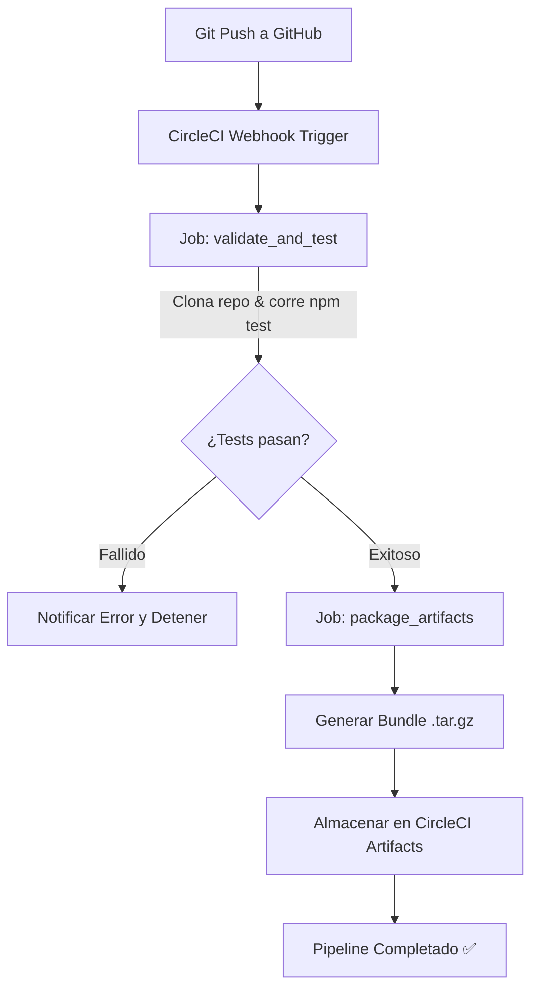

<div align="center">

# 🛰️ AETHERIA // ORBIT AI
### *Orbital Deep Space Telemetry Hub & Quantum Observation Deck*

[](https://circleci.com/)
[](https://developer.mozilla.org/en-US/docs/Web/HTML)
[](https://developer.mozilla.org/en-US/docs/Web/CSS)
[](https://developer.mozilla.org/en-US/docs/Web/JavaScript)
[](https://circleci.com/)
[](LICENSE)

<br/>

**Aetheria // Orbit AI** es una aplicación web moderna y de alto impacto estético inspirada en centros de control aeroespaciales de última generación. Diseñada desde cero para demostrar la integración completa entre **GitHub** y canalizaciones de integración continua (**CI/CD**) automatizadas con **CircleCI**.

[Explorar Características](#-características-principales) • [Arquitectura CI/CD](#-arquitectura-del-pipeline-en-circleci) • [Paso a Paso GitHub](#-paso-a-paso-1-subir-el-proyecto-a-github) • [Paso a Paso CircleCI](#-paso-a-paso-2-conectar-github-con-circleci)

</div>

---

## 🌌 Vista General de la Aplicación

```
┌────────────────────────────────────────────────────────────────────────────┐
│  [🛰️ AETHERIA v2.5]       STATUS: CIRCLECI VERIFIED    ⏱ 13:28:40 UTC  🔇 │
├────────────────────────────────────────────────────────────────────────────┤
│                                                                            │
│  MISIÓN ORBITAL EXPLORER-9 // SECTOR ZETA          [ (●) RADAR MATRIZ ]   │
│  Telemetría Cuántica & Exploración Cósmica             3 Objetos en rango  │
│  [ Iniciar Escaneo ]   [ ⚡ Simular Tormenta ]                            │
│                                                                            │
├────────────────────────────────────────────────────────────────────────────┤
│  🚀 Velocidad: 27,540 km/h   ⚛ Núcleo: 2.71 K   📡 Latencia: 18 ms        │
├────────────────────────────────────────────────────────────────────────────┤
│  [Matriz de Espectrografía]   🪐 Kepler-452b | 🌌 M16 | ❄️ Europa | 🌀 Sgr A*│
├────────────────────────────────────────────────────────────────────────────┤
│  > orbit-ai:~$ [Terminal interactiva y streaming de logs de telemetría]    │
└────────────────────────────────────────────────────────────────────────────┘
```

---

## ✨ Características Principales

1. **Diseño Visual Ultra-Premium (Sci-Fi Glassmorphism)**:
   - Paleta cromática profunda de espacio interestelar con acentos cian eléctrico (`#00f2fe`), violeta galáctico (`#7928ca`) y esmeralda (`#00f5a0`).
   - Efectos de desenfoque de fondo dinámico (`backdrop-filter: blur(18px)`), bordes luminiscentes y tipografías modernas (*Outfit*, *Space Grotesk* y *JetBrains Mono*).

2. **Lienzo de Partículas & Constelaciones Interactivas (`Canvas 2D`)**:
   - Más de 130 estrellas dinámicas con deriva suave, oscilación de brillo estelar y generación de constelaciones reactivas a la posición del cursor del usuario.

3. **Sintetizador de Audio Web (Web Audio API)**:
   - Generación procedimental de frecuencias armónicas e interactivas sin necesidad de archivos de audio externos (100% ligero y autocontenido).

4. **Matriz de Espectrometría Exoplanetaria**:
   - Pestañas interactivas para examinar datos de exoplanetas como Kepler-452b, los Pilares de la Creación, el Océano de Europa y Sagitario A*.

5. **Terminal de Comandos Interactiva**:
   - Consola embebida con streaming de logs en tiempo real y soporte para comandos como `help`, `scan`, `flare`, `circleci`, `status` y `clear`.

6. **Radar Orbital con Detección de Objetos en Rango**:
   - Escaneo rotativo continuo con detección de sondas y anomalías estelares.

---

## 🛠️ Estructura del Repositorio

```bash
circleCi/
├── .circleci/
│   └── config.yml         # Configuración del pipeline de CI/CD para CircleCI (v2.1)
├── test/
│   └── test.js            # Suite de pruebas automatizadas (ejecutadas por CircleCI)
├── .gitignore             # Archivos y dependencias excluidas del control de versiones
├── app.js                 # Motor interactivo, Canvas 2D y lógica de telemetría
├── index.html             # Estructura semántica HTML5 con SEO y accesibilidad
├── package.json           # Definición del proyecto, scripts npm y metadata
├── README.md              # Documentación técnica profesional del repositorio
└── style.css              # Sistema de diseño con variables CSS y Glassmorphism
```

---

## ⚙️ Arquitectura del Pipeline en CircleCI

La canalización se encuentra definida en [`.circleci/config.yml`](file:///.circleci/config.yml) y consta de dos trabajos (*jobs*) encadenados:



* **Job 1 (`validate_and_test`)**: Levanta una imagen Docker oficial `cimg/node:20.11.0`, verifica la integridad estructural de los archivos HTML, CSS y JS, y ejecuta la suite de validación `npm test`.
* **Job 2 (`package_artifacts`)**: Empaqueta automáticamente los archivos de producción en un archivo comprimido `orbit-ai-release-v1.0.0.tar.gz` y lo publica en la pestaña de **Artifacts** de CircleCI para su descarga o despliegue.

---

## 🚀 Paso a Paso 1: Subir el Proyecto a GitHub

Sigue estos sencillos comandos en tu terminal (PowerShell o Git Bash) desde la carpeta del proyecto:

### 1. Inicializar el repositorio Git local
```bash
git init
```

### 2. Configurar la rama principal como `main`
```bash
git branch -M main
```

### 3. Agregar todos los archivos al área de preparación
```bash
git add .
```

### 4. Realizar el primer commit
```bash
git commit -m "feat: initial commit of Aetheria Orbit AI telemetry hub with CircleCI pipeline"
```

### 5. Crear el repositorio en GitHub
1. Abre tu navegador e ingresa a [GitHub](https://github.com/new).
2. Asigna un nombre al repositorio, por ejemplo: `circleci-orbit-ai`.
3. Selecciona que sea **Público** (recomendado para que CircleCI en su capa gratuita lo procese inmediatamente sin restricciones de minutos).
4. **NO marques** las casillas de *"Add a README file"*, *"Add .gitignore"* ni *"Choose a license"*, ya que las tenemos creadas localmente.
5. Haz clic en **Create repository**.

### 6. Vincular el repositorio remoto y subir el código
Copia la URL de tu repositorio creado (sustituye `TU_USUARIO` por tu usuario real de GitHub):
```bash
git remote add origin https://github.com/TU_USUARIO/circleci-orbit-ai.git
git push -u origin main
```

---

## 🔄 Paso a Paso 2: Conectar GitHub con CircleCI

Una vez que tu repositorio esté en GitHub:

### 1. Iniciar sesión en CircleCI
* Entra a [https://circleci.com/](https://circleci.com/).
* Haz clic en **Log In** o **Sign Up** y selecciona **Log in with GitHub**.
* Concede los permisos necesarios para que CircleCI pueda leer tus repositorios.

### 2. Localizar tu Proyecto en CircleCI
1. En el panel izquierdo de CircleCI, haz clic en **Projects**.
2. Verás una lista con tus repositorios de GitHub.
3. Busca `circleci-orbit-ai` (o el nombre que le hayas dado).
4. Haz clic en el botón azul **Set Up Project**.

### 3. Configurar el Pipeline
CircleCI te preguntará cómo deseas configurar el proyecto:
* Selecciona la opción: **"Fastest: Use the `.circleci/config.yml` in my repo"**.
* En el campo de rama (*branch*), confirma que esté seleccionada la rama `main`.
* Haz clic en **Set Up Project** (o **Trigger Pipeline**).

### 4. ¡Observar la magia del CI/CD!
1. CircleCI comenzará a ejecutar de forma automática tu pipeline:
   - Verás el workflow `build_test_and_package`.
   - El job `validate_and_test` clonará el repositorio y correrá las pruebas.
   - El job `package_artifacts` creará el archivo comprimido.
2. Ambos trabajos se mostrarán con una insignia verde: **SUCCESS**.
3. Haz clic en el job `package_artifacts` y navega a la pestaña **Artifacts**: verás allí el archivo `orbit-ai-release-v1.0.0.tar.gz` generado automáticamente.

### 5. Añadir el Badge de Estado a tu README (Opcional pero recomendado)
En CircleCI:
1. Ve a **Project Settings** (icono de engranaje) > **Status Badges**.
2. Copia el código Markdown del badge.
3. Reemplaza `<YOUR_GITHUB_USERNAME>` en la cabecera de este archivo `README.md` para que el badge muestre el estado en vivo de tus compilaciones.

---

## 💻 Ejecución y Pruebas Locales

Para probar el proyecto o la suite de pruebas en tu computadora antes de hacer commit:

```bash
# Ejecutar la suite de pruebas automatizadas
npm test

# Ejecutar el linter de sintaxis
npm run lint

# Probar la web localmente (con cualquier servidor estático)
npx serve .
# O abre directamente el archivo index.html en tu navegador preferido
```

---

## 📜 Licencia

Distribuido bajo la Licencia **MIT**. Consulta el archivo `LICENSE` para más información.
Desarrollado con pasión para la integración continua moderna en la nube.
